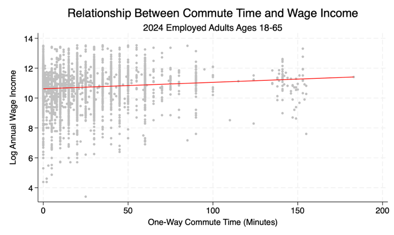

# Commute Time and Wage Income

An econometric analysis of how one-way commute time relates to annual wage income among 1.39 million employed U.S. adults, using 2024 IPUMS USA microdata and Stata.

## Overview

This project examines the relationship between commute time and annual wage income among employed adults in the United States. Commuting is a real cost to workers in time, money, and stress, and with the rise of remote work, understanding how the labor market compensates for that cost is increasingly relevant. Using 2024 IPUMS USA microdata, I estimate a series of OLS regressions in Stata, progressively adding controls to test whether the commute–wage relationship holds.

## Key Findings



| Model | Controls added | Commute coefficient (per 10 min) | R² |
|---|---|---|---|
| (1) | None (baseline OLS) | 0.031*** (≈ 3.1%) | 0.005 |
| (2) | + Age, gender | 0.022*** | 0.110 |
| (3) | + Education | 0.027*** | 0.240 |
| (4) | + Race | 0.028*** | 0.243 |
| (5) | + Weekly hours, commute × female | 0.012*** (≈ 1.2%) | 0.426 |

<sub>Robust standard errors. *** p < 0.01. N = 1,392,789 in all models.</sub>

- **Longer commutes are associated with higher wages.** Each additional 10 minutes of one-way commute is associated with about 3.1% higher annual wage income before controls and about 1.2% after all controls.
- **The relationship survives controls.** The coefficient shrinks as controls are added, which indicates omitted variable bias in the baseline, but it stays positive and significant at the 1% level.
- **Women see a slightly larger association.** The commute × female interaction is positive (0.004), which implies about 1.6% per 10 minutes for women vs. 1.2% for men.
- **Controls explain much of the wage variation.** R² rises from 0.005 to 0.426, with education and hours worked adding the most explanatory power.

## Data

- **Source:** IPUMS USA, 2024 American Community Survey
- **Unit of observation:** Individual
- **Sample:** Employed adults ages 18–65 with positive wage income
- **Observations:** 1,392,789

| Variable | Description |
|---|---|
| `ln_wage` | Natural log of annual wage and salary income |
| `commute10` | One-way commute time in 10-minute units |
| `age` | Age in years |
| `female` | Indicator for female |
| `educ4` | Education: less than HS, HS, some college, bachelor's or higher |
| `race4` | Race: White, Black, Asian, other/multiracial |
| `uhrswork` | Usual weekly hours worked |

## Methodology

The full specification is:

```
ln(Wage) = β0 + β1·Commute10 + β2·Female + β3·(Commute10 × Female) + β4·Age
         + Education dummies + Race dummies + β·WeeklyHours + ε
```

- Wage income is log-transformed to reduce skew and so that coefficients can be read as approximate percent changes.
- Commute time is scaled to 10-minute units for interpretability.
- Education and race enter as categorical dummies. The reference groups are "less than high school" and "White."
- The commute × female interaction tests whether the commute–wage relationship differs by gender.
- All models use heteroskedasticity-robust standard errors.

## Limitations

- Results are **correlational, not causal**. Unobserved factors such as industry, occupation, local cost of living, and skills may affect both commute time and wages.
- IPUMS codes respondents who work from home as having a 0-minute commute. These respondents are included in the sample.
- Estimates are unweighted national averages and may vary considerably across states and metro areas.

## How to Reproduce

1. Create an IPUMS USA extract from the **2024 ACS sample** with these variables: `AGE`, `SEX`, `EMPSTAT`, `INCWAGE`, `TRANTIME`, `EDUC`, `RACE`, `UHRSWORK`.
2. Save it as `Data/IPUMS_2024.dta`. Raw data are not included in this repository, per IPUMS terms of use.
3. Install the required Stata packages:
   ```stata
   ssc install outreg2
   ssc install estout
   ```
4. Create an `Output/` folder and run `commute_wage_analysis.do`. Tables and the figure are saved to `Output/`.

## Repository Contents

- `commute_wage_analysis.do`: Stata code for data cleaning, regressions, tables, and figure
- `commute_wage_research_paper.pdf`: Full research paper with methodology, results, and discussion
- `Output/`: Regression table, summary statistics, and figure

## Tools & Skills

Stata · OLS regression · Interaction terms · Categorical controls · Data cleaning · Large-scale microdata analysis · Statistical interpretation · Data visualization

## Data Citation

Steven Ruggles, Sarah Flood, Matthew Sobek, et al. *IPUMS USA: Version 15.0* [dataset]. Minneapolis, MN: IPUMS, 2024. https://usa.ipums.org/usa/

## Author

**Willa Hock**
B.A. Economics, Boston University
